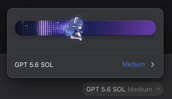

# dsh-reasoning-effort

dsh 0.2 思考等级与视觉能力解放插件

兼容 DSH `0.2.0-rc.2`。

1. 按家族手动维护 `models/*.toml`，为常见的模型自动补全 `reasoning_effort`
2. 为第三方模型自动补全正确的上下文窗口与最大输出长度（避免回退到适配器保守的 262k）
3. 解锁第三方模型原生的视觉能力
4. 在 Composer 中加入鲸鱼娘推理强度滑块
5. 通过 DSH 原生 ConfigForm 实时读写插件配置



## 模型目录维护

模型目录按家族拆分在 `models/` 下，每个文件对应一个家族：

```text
models/
  gpt.toml
  claude.toml
  gemini.toml
  qwen.toml
  ...
```

每个 TOML 文件声明 `family` 和一组 `[[models]]`。例如：

```toml
family = "gpt"

[[models]]
model = "gpt-5.4"
aliases = []
input = ["text", "image"]
contextWindow = 1050000
maxOutputTokens = 128000

[models.pricing]
currency = "USD"
unit = "per_million_tokens"
input = 2.5
output = 15
cacheRead = 0.25

[models.reasoningEfforts]
low = "low"
medium = "medium"
high = "high"
xhigh = "xhigh"

[models.sources]
capabilities = "https://models.dev/api.json"
pricing = "https://developers.openai.com/api/docs/models/gpt-5.4"
```

TOML 没有 `null`：可选价格、容量等字段省略即表示未知；`reasoningEfforts.off`
由生成器自动补为 `null`，源文件中不要手写。

修改 TOML 后运行：

```bash
pnpm run generate:models  # 重新生成 src/model-catalog.generated.json
pnpm run check:models     # 检查生成物是否与 TOML 一致
```

## 构建

```bash
pnpm install
pnpm run build
pnpm run typecheck
pnpm test
```

## 安装（本地源码）

```bash
cd /absolute/path/to/dsh-reasoning-effort
pnpm install && pnpm run build

# 链接进 web profile。包内 cordis.patch.yml（package.json 的 dsh.bundle 声明）
# 会自动把 providers-reasoning 插件行挂进 profile 层栈，无需手写 patch。
dsh plugin --profile web add link:$PWD
```

## License

MIT。第三方素材（鲸鱼精灵图）的来源与版权声明已并入 [`LICENSE`](./LICENSE)。
